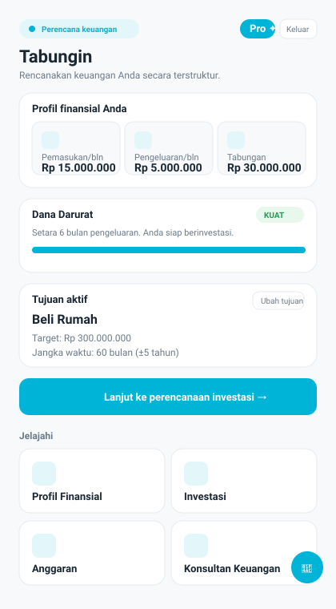
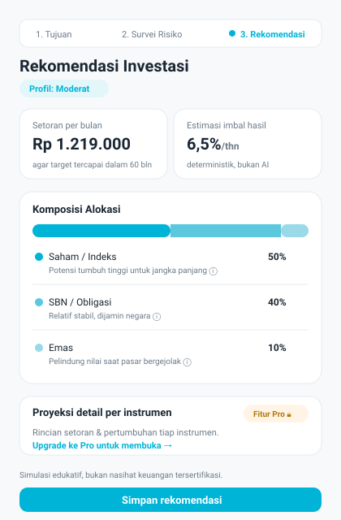
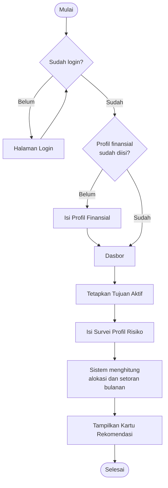
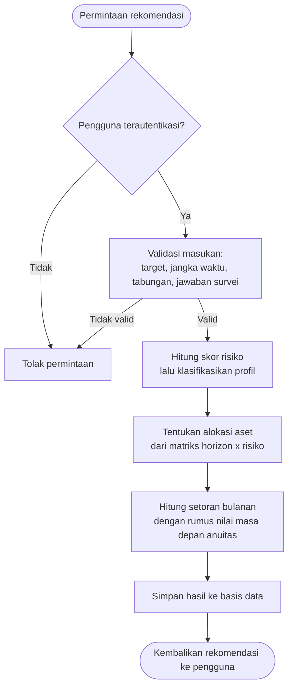
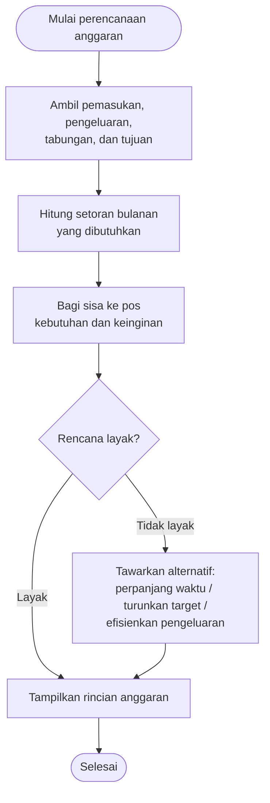

# BAB 3 PERANCANGAN SISTEM/SOLUSI

Bagian ini memaparkan bagaimana solusi dirancang, mulai dari menggali apa yang sebenarnya dibutuhkan pengguna, menerjemahkannya menjadi arsitektur aplikasi, lalu menuangkannya ke dalam rancangan antarmuka dan alur proses. Perancangan di sini sengaja dibuat bertahap: saya tidak langsung melompat ke desain teknis, melainkan berangkat dari persoalan nyata yang dihadapi calon pengguna, baru kemudian menentukan bentuk sistem yang paling masuk akal untuk menjawabnya.

## 3.1 Analisis Kebutuhan Pengguna

### 3.1.1 Profil dan Permasalahan Pengguna

Sasaran utama aplikasi ini adalah individu yang ingin menata keuangan pribadinya namun belum tentu memahami seluk-beluk investasi. Dari pengamatan terhadap kelompok pengguna seperti ini, persoalan yang muncul biasanya bukan karena mereka malas menabung, melainkan karena mereka kebingungan menentukan langkah: berapa yang sebenarnya perlu disisihkan tiap bulan, instrumen apa yang cocok, dan apakah targetnya realistis atau tidak. Informasi finansial memang berlimpah, tetapi justru keberlimpahan itulah yang kerap membuat pemula merasa kewalahan.

Berangkat dari situ, kebutuhan pengguna saya rumuskan ke dalam beberapa titik berikut. Pertama, pengguna butuh gambaran kondisi keuangannya sendiri secara ringkas sebelum melangkah lebih jauh. Kedua, mereka perlu arahan yang konkret, bukan sekadar wacana umum — misalnya angka nominal yang harus ditabung, bukan nasihat "mulailah berinvestasi sejak dini". Ketiga, karena target pengguna adalah orang awam, bahasa dan tampilan harus sederhana dan tidak menghakimi kebiasaan finansial mereka.

### 3.1.2 Kebutuhan Fungsional

Dari pemetaan persoalan di atas, kebutuhan fungsional sistem dapat diringkas sebagai berikut:

1. **Pengelolaan profil finansial.** Pengguna dapat mencatat pemasukan bulanan, pengeluaran bulanan, dan tabungan yang dimiliki saat ini. Data ini menjadi pintu masuk wajib — tanpa mengisinya, fitur lanjutan dikunci agar perhitungan tidak berjalan di atas data kosong.
2. **Penetapan tujuan keuangan.** Pengguna menetapkan satu tujuan aktif berupa nominal target beserta jangka waktunya (dalam satuan bulan), misalnya terkumpul seratus juta dalam lima tahun.
3. **Rekomendasi investasi berbasis aturan.** Sistem menilai profil risiko lewat survei singkat, lalu mengeluarkan rekomendasi alokasi aset dan estimasi setoran bulanan yang diperlukan untuk mencapai tujuan. Perhitungan ini bersifat deterministik, bukan hasil kecerdasan buatan.
4. **Perencanaan anggaran berbasis tujuan.** Alih-alih pengguna menebak persentase, sistem menghitung berapa yang mesti ditabung tiap bulan dari pemasukan, lalu membagi sisanya ke pos kebutuhan dan keinginan. Bila rencananya tidak layak, sistem menawarkan beberapa alternatif penyesuaian.
5. **Asisten percakapan.** Tersedia chatbot yang memahami konteks data pengguna sehingga bisa menjawab pertanyaan finansial tanpa menanyakan ulang angka yang sudah tersimpan.
6. **Akun dan privasi data.** Setiap pengguna memiliki akun sendiri sehingga datanya terpisah dan tidak tercampur dengan pengguna lain.

### 3.1.3 Kebutuhan Non-Fungsional

Di luar fungsi, terdapat sejumlah syarat kualitas yang ikut membentuk rancangan. Dari sisi keamanan, kata sandi tidak boleh disimpan dalam bentuk apa adanya dan setiap data keuangan harus terikat pada pemiliknya. Dari sisi keterpahaman, seluruh antarmuka dan istilah menggunakan Bahasa Indonesia dengan penjelasan ramah pemula. Dari sisi keterpercayaan angka, hasil hitungan harus konsisten dan dapat ditelusuri rumusnya, sehingga setiap rekomendasi dibangun di atas fungsi perhitungan murni yang terpisah dari antarmuka. Terakhir, dari sisi keberlanjutan biaya, pemakaian layanan kecerdasan buatan perlu dibatasi agar beban operasional tetap terkendali.

### 3.1.4 Ringkasan Kebutuhan

| Kode | Kebutuhan | Jenis | Pemangku Kepentingan |
|---|---|---|---|
| KF-01 | Mengisi dan memperbarui profil finansial | Fungsional | Pengguna |
| KF-02 | Menetapkan tujuan keuangan aktif | Fungsional | Pengguna |
| KF-03 | Memperoleh rekomendasi investasi dari survei risiko | Fungsional | Pengguna |
| KF-04 | Menyusun anggaran berbasis tujuan beserta penilaian kelayakan | Fungsional | Pengguna |
| KF-05 | Berkonsultasi melalui asisten percakapan | Fungsional | Pengguna |
| KF-06 | Mengakses akun pribadi yang datanya terisolasi | Fungsional | Pengguna |
| KNF-01 | Kata sandi tersimpan dalam bentuk ter-hash | Non-fungsional | Pengelola |
| KNF-02 | Antarmuka berbahasa Indonesia dan ramah pemula | Non-fungsional | Pengguna |
| KNF-03 | Perhitungan deterministik dan dapat ditelusuri | Non-fungsional | Pengguna, Pengelola |
| KNF-04 | Pembatasan pemakaian layanan AI | Non-fungsional | Pengelola |

## 3.2 Desain Sistem/Aplikasi

### 3.2.1 Gambaran Umum Arsitektur

Secara garis besar, aplikasi dibangun sebagai aplikasi web dengan kerangka kerja Next.js yang menyatukan sisi tampilan dan sisi layanan dalam satu basis kode. Pilihan ini saya ambil karena memudahkan pemisahan tanggung jawab tanpa harus mengelola dua proyek terpisah. Lapisan tampilan menangani interaksi pengguna, lapisan layanan (API) menangani validasi dan penyimpanan, sementara seluruh logika bisnis perhitungan diletakkan sebagai fungsi murni yang berdiri sendiri agar dapat diuji dan dipakai ulang.

Struktur sistem dapat dipandang dalam tiga lapisan:

- **Lapisan antarmuka**, berisi halaman seperti dasbor, profil, investasi, perencana anggaran, serta panel percakapan yang tersedia di seluruh halaman.
- **Lapisan layanan**, berupa titik akhir API untuk profil, tujuan, rekomendasi, anggaran, autentikasi, dan percakapan. Setiap titik akhir memvalidasi masukan dan menolak permintaan yang tidak sah.
- **Lapisan logika dan data**, mencakup kumpulan fungsi perhitungan (alokasi aset, proyeksi setoran, penilaian risiko, dana darurat) serta basis data PostgreSQL yang dikelola melalui ORM.

### 3.2.2 Pemisahan Logika Perhitungan

Satu keputusan desain yang cukup menentukan adalah menempatkan seluruh perhitungan finansial sebagai fungsi murni yang tidak bergantung pada tampilan maupun basis data. Alasannya praktis: hasil rekomendasi harus bisa dipercaya dan diperiksa ulang. Dengan memisahkan logika ini, estimasi setoran bulanan dapat diverifikasi lewat pengujian unit, dan tim mana pun yang membaca kode dapat menelusuri rumusnya tanpa harus membongkar antarmuka. Perhitungan setoran bulanan, misalnya, memakai rumus nilai masa depan anuitas yang memperhitungkan tabungan awal, estimasi imbal hasil tahunan, dan jangka waktu — bukan angka yang dikarang oleh model bahasa.

### 3.2.3 Rancangan Basis Data

Basis data dirancang mengikuti alur penggunaan. Entitas inti adalah profil finansial dan tujuan, yang menjadi rujukan bagi hampir seluruh fitur. Hasil survei risiko dan rekomendasi investasi disimpan sebagai riwayat, sementara rencana anggaran disimpan terpisah. Untuk mendukung akun, ditambahkan entitas pengguna, dan setiap data keuangan ditautkan pada pemiliknya. Tabel pendukung lain mencatat pemakaian percakapan harian dan permintaan konsultasi.

| Entitas | Peran dalam Sistem |
|---|---|
| User | Akun pengguna beserta status langganannya |
| FinancialProfile | Kondisi keuangan dasar; menjadi gerbang wajib |
| Goal | Tujuan keuangan aktif (target dan jangka waktu) |
| RiskAssessment | Hasil dan skor survei profil risiko |
| InvestmentRecommendation | Rekomendasi alokasi dan setoran yang tersimpan |
| BudgetPlan | Rencana anggaran berbasis tujuan |
| ChatUsage | Pencatatan kuota percakapan harian per pengguna |
| Booking | Permintaan konsultasi ke konsultan keuangan |

### 3.2.4 Alur Autentikasi dan Isolasi Data

Agar data tiap pengguna tidak tercampur, identitas pengguna selalu diambil dari sesi yang tersimpan di sisi peladen, bukan dari data yang dikirim peramban. Dengan begitu, setiap pembacaan data disaring berdasarkan pemiliknya. Kata sandi disimpan dalam bentuk ter-hash, dan sesi diwakili oleh token bertanda tangan yang disimpan pada berkas kuki yang tidak dapat diakses skrip di sisi klien.

## 3.3 Desain Mockup/Prototype

Rancangan antarmuka dibuat seminimal mungkin agar pengguna awam tidak kewalahan. Prinsipnya satu layar untuk satu keputusan: pengguna dibimbing langkah demi langkah alih-alih dihadapkan pada formulir panjang yang memuat segalanya sekaligus. Berikut gambaran purwarupa dari layar-layar utama.

### 3.3.1 Halaman Dasbor

Dasbor berfungsi sebagai titik awal. Di sini pengguna melihat ringkasan kondisi keuangannya, indikator kesiapan dana darurat, serta kartu tujuan aktif. Dari dasbor pula pengguna diarahkan menuju fitur investasi, anggaran, maupun daftar konsultan.

*Gambar 3.1 Rancangan antarmuka halaman dasbor.*

### 3.3.2 Halaman Profil Finansial

Formulir profil hanya meminta tiga hal: pemasukan, pengeluaran, dan tabungan saat ini. Masing-masing diberi catatan penjelas, misalnya anjuran membagi rata pengeluaran tahunan agar estimasinya lebih jujur.

### 3.3.3 Alur Investasi

Alur investasi menampilkan tiga tahap berurutan: menegaskan tujuan, mengisi survei risiko singkat, lalu menerima kartu rekomendasi berisi komposisi alokasi dan estimasi setoran bulanan. Tiap instrumen disertai keterangan ringkas agar pemula tidak perlu menebak maksudnya.

*Gambar 3.2 Rancangan antarmuka kartu rekomendasi investasi.*

### 3.3.4 Catatan Mengenai Purwarupa

Purwarupa pada tahap ini bersifat purwarupa fungsional, artinya tata letaknya memang telah diwujudkan dalam aplikasi yang berjalan, bukan sekadar gambar statis. Pendekatan ini saya pilih karena umpan balik atas interaksi nyata jauh lebih berguna ketimbang menilai mockup diam, terutama untuk memastikan alur bertahap tadi benar-benar terasa ringan bagi pengguna.

## 3.4 Diagram Alur

### 3.4.1 Alur Proses Utama Pengguna

Diagram berikut menggambarkan perjalanan pengguna sejak masuk hingga memperoleh rekomendasi. Perhatikan adanya dua gerbang: gerbang autentikasi dan gerbang profil. Keduanya sengaja dipasang untuk memastikan sistem tidak menghitung apa pun di atas data yang belum lengkap.

*Gambar 3.3 Diagram alur proses utama pengguna.*

### 3.4.2 Alur Perhitungan Rekomendasi Investasi

Diagram di bawah merinci apa yang terjadi di sisi peladen ketika pengguna meminta rekomendasi. Yang perlu digarisbawahi, keputusan angka sepenuhnya ditentukan oleh aturan, bukan oleh model bahasa.

*Gambar 3.4 Diagram alur perhitungan rekomendasi investasi.*

### 3.4.3 Alur Perencanaan Anggaran Berbasis Tujuan

Berbeda dari pendekatan konvensional yang meminta pengguna menebak persentase, perencana anggaran membalik logikanya: pengguna memberi tujuan, sistem menghitung berapa yang harus ditabung, lalu menilai kelayakannya.

*Gambar 3.5 Diagram alur perencanaan anggaran berbasis tujuan.*

### 3.4.4 Penutup Perancangan

Secara keseluruhan, rancangan ini berusaha menjaga keseimbangan antara kemudahan bagi pengguna awam dan ketepatan di sisi perhitungan. Gerbang-gerbang pada alur memastikan data selalu lengkap sebelum diproses, pemisahan logika menjaga agar angka dapat dipertanggungjawabkan, dan antarmuka yang dibuat bertahap menurunkan beban kognitif. Rancangan inilah yang menjadi dasar bagi tahap implementasi dan pengujian pada bab berikutnya.
